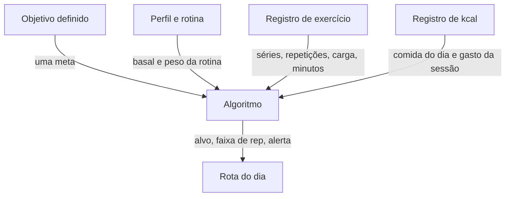

# Arquitetura

O BodyEvolve é modelado em DDD. O código da API traduz o domínio de negócio: cada problema do produto vira um contexto com nome, dados e regra próprios. Um contexto não recalcula a regra do outro. O algoritmo só lê o que os registros já guardaram e devolve a rota do dia.

O cliente em React mostra telas e envia o que a pessoa fez. Não escolhe percentual de meta, não compara carga e não soma caloria. Isso fica na API Laravel, dentro dos contextos. O Postgres guarda o histórico. `compose.local` sobe só o banco, para a API rodar na máquina contra um Postgres de verdade. `compose.prod` sobe cliente, API e banco juntos.

## Como o DDD está aplicado

Um contexto limitado é uma solução independente. Ele tem uma língua só e um motivo só para mudar.

| Contexto | O que resolve | O que guarda |
| --- | --- | --- |
| Acesso | Entrar e sair da conta | E-mail e senha cifrada |
| Objetivo | Uma meta por pessoa | Hipertrofia, emagrecimento, força ou resistência |
| Perfil | Quem é a pessoa e quão ativo é o dia | Idade, sexo, altura, peso, rotina |
| Registro de exercício | O que foi treinado | Sessão, exercício, séries, repetições, carga |
| Registro de kcal | O que foi comido e o gasto da sessão | Comida do dia e kcal líquida da sessão |
| Algoritmo | A rota está certa? | Não guarda fato novo. Lê os outros e devolve alvo, progressão e alerta |

O algoritmo é o único lugar que junta os contextos. Ele aplica as contas de [nutritional-plan](../domain/nutritional-plan.md), [consumption](../domain/consumption.md) e [stimulus](../domain/stimulus.md). Objetivo não sabe somar série. Registro de exercício não decide superávit. Registro de kcal não decide se a carga subiu.

## Como a solução funciona



A pessoa define o objetivo e o perfil uma vez. Cada treino entra no registro de exercício. Cada dia de comida entra no registro de kcal. O algoritmo cruza os quatro e devolve a rota: calorias da meta, quantas repetições fazer, se a carga chegou no teto e se o dia desviou.

## Tecnologias

Versões estáveis em 16 de outubro de 2026. PostgreSQL 19 ainda está em release candidate, então o banco fica na linha 18.

| Peça | Versão | Por quê |
| --- | --- | --- |
| PHP | 8.5 | É o runtime mais novo que o Laravel 13 aceita, e o Pest 5 exige PHP 8.4 ou mais. |
| Laravel | 13.36 | A API e os contextos DDD moram aqui. Autenticação, validação e o algoritmo ficam no mesmo processo, sem um serviço por regra. |
| React | 19.3.1 | O cliente só apresenta a rota e coleta objetivo, treino e comida. Não duplica a conta. |
| PostgreSQL | 18.6 | O histórico de carga, repetição e comida é relacional. Uma pessoa, uma meta, várias sessões. |
| L5-Swagger | 11.2 | Publica o contrato HTTP em Swagger, a partir de atributos OpenAPI no código de cada contexto. Usa swagger-php 6 e Swagger UI 5. A documentação nasce junto da rota, então o contrato não vive num arquivo solto. |
| Pest | 5.3.2 | Testa as regras do algoritmo em PHP, em cima do PHPUnit 13.4, sem subir a tela. |
| Laravel Pint | 1.32 | É o linter da API. Recusa PHP fora do estilo do Laravel. |
| Vitest | 5.0.5 | Testa as telas React. Confere se o cliente envia o que a pessoa digitou e mostra a rota que a API devolveu. Não repete a conta de basal, rotina ou carga. |
| ESLint | 10 | É o linter do cliente. Recusa a tela fora da regra do projeto. |
| GitHub Actions | ci-cd.yml | Em todo push e pull request roda Pint, Pest, ESLint e Vitest. O mesmo arquivo é a porta de entrada e a porta de entrega: o main só segue com esses quatro verdes. |
| k6 | 1.8.2 | Simula muitas requests ao mesmo tempo contra a API. |
| OWASP ZAP | 2.17.0 | Percorre a API autenticada e aponta falha de segurança exposta no HTTP. |

## Estrutura do repositório

Um repositório, um processo. API e cliente são pastas do mesmo monólito, e o código de cada um é separado pelo contexto. Não há serviço por domínio.

```text
├── .github/
│   └── workflows/
│       └── ci-cd.yml                   # Pint, Pest, ESLint e Vitest
├── README.md
├── docs/
│   ├── software-domain.md              # mapa do produto
│   ├── domain/
│   │   ├── cardio.md                   # catálogo de cardio
│   │   ├── sports.md                   # catálogo de esportes
│   │   ├── strong.md                   # catálogo de força
│   │   ├── consumption.md              # MET e kcal da sessão
│   │   ├── nutritional-plan.md         # basal, rotina e macros
│   │   └── stimulus.md                 # faixa de rep e progressão de carga
│   └── system/
│       ├── architecture.md
│       ├── backlog.md                  # histórias de uso
│       └── schema.md                   # modelo de dados
├── api/                                # Laravel 13
│   ├── app/
│   │   ├── Acesso/                     # entrar e sair
│   │   ├── Objetivo/                   # uma meta por pessoa
│   │   ├── Perfil/                     # idade, sexo, altura, peso, rotina
│   │   ├── RegistroDeExercicio/        # sessão, séries, reps, carga
│   │   ├── RegistroDeKcal/             # comida do dia e gasto da sessão
│   │   └── Algoritmo/                  # lê os outros e devolve a rota
│   └── tests/                          # Pest, um diretório por contexto
│       ├── Acesso/
│       ├── Objetivo/
│       ├── Perfil/
│       ├── RegistroDeExercicio/
│       ├── RegistroDeKcal/
│       └── Algoritmo/
└── client/                             # React 19
    └── src/
        ├── acesso/
        ├── objetivo/
        ├── perfil/
        ├── registro-de-exercicio/
        ├── registro-de-kcal/
        └── rota/                       # só exibe o que o Algoritmo devolveu
```

O atributo OpenAPI fica na entrada HTTP de cada pasta em `api/app/`, e o L5-Swagger gera o contrato a partir dela. O Vitest cobre as pastas de `client/src/`. Rotas, config e migrations do Laravel ficam na casca do framework, fora desses nomes.

O [ci-cd.yml](../../.github/workflows/ci-cd.yml) sobe PHP 8.5 e Postgres 18 para a API, e Node 24 para o cliente. Na API o comando é `vendor/bin/pint --test` e `vendor/bin/pest`. No cliente, `npm run lint` chama o ESLint e `npm test` chama o Vitest uma vez, sem modo de observação.

## Próximas ações

Os testes de segurança e de desempenho ainda não rodam. São o passo seguinte, com a API no ar.

- **Segurança.** O ZAP 2.17 percorre os fluxos de entrar, lançar treino e lançar comida com uma sessão autenticada. O relatório aponta o que a API deixa escapar. A falha encontrada vira correção antes de repetir o teste.
- **Desempenho.** O k6 1.8 dispara várias requests simultâneas nos mesmos fluxos: entrar, abrir a rota do dia, gravar exercício e gravar kcal. O alvo é ver em que volume a API deixa de responder no tempo do uso normal. O número de usuários virtuais e o limite de tempo ficam no script do k6, não na regra de negócio.
