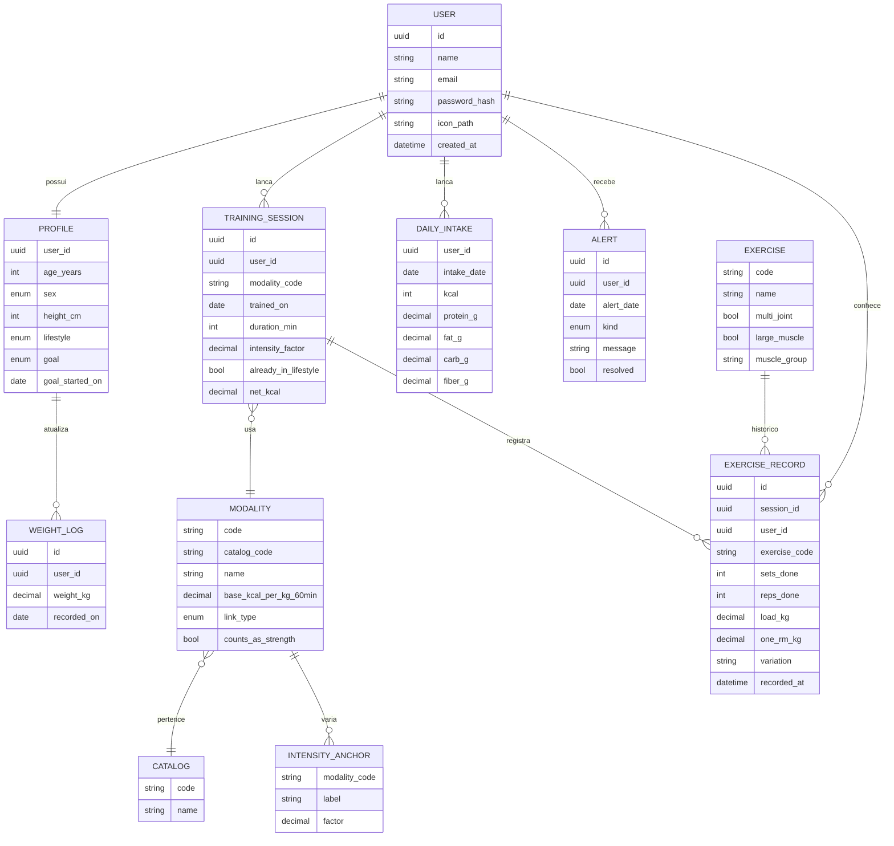

# Schema

Modelo da plataforma. Uma pessoa, uma meta. O histórico de exercício, carga, repetições e séries fica gravado a cada lançamento. A faixa que o app mostra vem de [stimulus](../domain/stimulus.md).

## Valores fechados

Sexo biológico: `masculino` ou `feminino`.

Estilo de vida: `sedentaria` (1.53), `moderada` (1.76), `vigorosa` (2.25).

Meta: `hipertrofia`, `emagrecimento`, `forca`, `resistencia`. Uma por perfil.

Catálogo: `strong`, `cardio`, `sports`.

Tipo de vínculo da modalidade: `direto`, `correspondencia`, `proxy`. O mesmo critério de [consumption](../domain/consumption.md).

`counts_as_strength` é verdadeiro nas modalidades de [strong](../domain/strong.md) e no halterofilismo. É falso no circuito de burpee, polichinelo e mountain climber.

Alerta: `deficit_na_hipertrofia`, `ingestao_fora_do_alvo`, `proteina_fora_do_alvo`, `sem_treino_de_forca`, `frequencia_baixa`, `carga_estagnada`, `volume_baixo`, `carboidrato_nao_coube`.

## O que cada tabela guarda

`USER` entra com e-mail e senha e guarda o nome. A senha fica só como `password_hash`. O ícone é um arquivo no disco local `public`, em `storage/app/public`. `icon_path` é o caminho desse arquivo dentro do disco, e pode ficar vazio. `php artisan storage:link` cria o atalho `public/storage` para essa pasta. A URL pública do ícone sai desse atalho.

`PROFILE` guarda idade, sexo, altura, rotina e a meta. O peso fica em `WEIGHT_LOG`. O cálculo usa o registro mais recente.

`MODALITY` e `INTENSITY_ANCHOR` são catálogo de gasto, não lançamento. A base é a coluna kcal/kg em 60 min. O fator 1 é a intensidade padrão e não precisa de linha.

`EXERCISE` é o catálogo que a pessoa escolhe na área de treino. O código não muda de uma sessão para outra. `multi_joint`, `large_muscle` e `muscle_group` vêm daqui, não de um texto digitado.

`TRAINING_SESSION` serve para cardio, esporte e força. `duration_min` e `intensity_factor` alimentam o gasto. `already_in_lifestyle` impede somar uma hora que o peso da rotina já cobriu. `net_kcal` é o resultado guardado da conta.

`EXERCISE_RECORD` é o histórico. Cada série de trabalho lançada cria uma linha nova: exercício, séries, repetições feitas, quilos e o instante. A linha antiga permanece. A progressão lê as linhas daquele `exercise_code` para a mesma pessoa, da mais recente para trás. `sets_done` é o que entra na conta de volume. `one_rm_kg` pode ficar vazio. Quando vem preenchido, a API usa o percentual de carga de [stimulus](../domain/stimulus.md). `variation` substitui `load_kg` na calistenia sem peso.

A faixa de repetições e o aumento de 2% ou 10% não são colunas. A API calcula os dois a partir da meta e desse histórico.

`DAILY_INTAKE` é um registro por pessoa e por data. Não há alimento nem tabela de micronutrientes.

`ALERT` nasce quando uma sessão ou a comida do dia é salva, e também quando o dia é aberto. Some quando a condição que o criou deixa de ser verdade.
